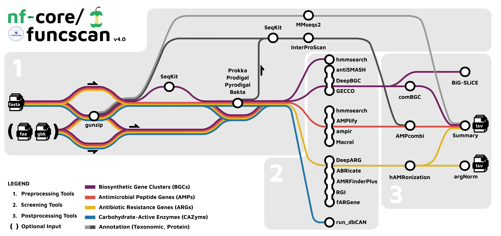

# Summary

Genome-mining of bacterial DNA enables the discovery of antimicrobial resistance-related genes, genes required for the biosynthesis of low molecular weight natural products, and other specialised metabolites.
However, execution of the multiple bioinformatic tools used in screening analyses remains inefficient due to heterogeneous software interfaces, reporting, and formatting of the output files of similar tools, which limits scalability of such analyses.

nf-core/funcscan is a portable and reproducible open source Nextflow bioinformatics pipeline for the screening of microbial functional features from assembled contigs or genomes.
The pipeline executes up to 13 tools to simultaneously identify biosynthetic gene clusters, antimicrobial peptides, antibiotic resistance genes, and carbohydrate-active enzymes, while also performing taxonomic classification of partial or full genomes.
To facilitate efficient results comparison and evaluation, it supports cross-tool output file standardisation and aggregation.

# Statement of need

Researchers often use multiple tools to maximize detection sensitivity during genomic screening for potential gene candidates, as each tool uses different search algorithms and microbial metabolite databases.
However, heterogeneous installations, inputs, and execution interfaces of these standalone tools impede scalability, and decrease reproducibility due to user-error when executed manually.
Additionally, output formats are not standardised, making cross-comparison of results between tools and databases difficult and requiring inefficient manual postprocessing and inspection.

The current need for manual execution and postprocessing impacts the discovery of new drugs.
The rise of multidrug resistant bacteria [@ventola_antibiotic_2015; @perry_prehistory_2016; @rascovan_exploring_2016] and reduction of global surveillance in healthcare and agriculture pose major threats to global health [@murray_global_2022; @world_health_organization_global_2022].
New antibiotics derived from low molecular weight bacterial natural products are needed to address these threats, but the discovery rate of novel molecules has declined as the rate of rediscovery has increased, necessitating the screening of ever larger metagenomic datasets. High-throughput and scalable approaches are needed to meet this challenge.

Here, we present nf-core/funcscan, a Nextflow [@di_tommaso_nextflow_2017] pipeline following nf-core best practices [@ewels_nf-core_2020;@Langer2025-th] for the automation of in-parallel screening of biosynthesis, antimicrobial resistance, and carbohydrate metabolism genes using multiple tools and databases.

# State of the field

Previous efforts to scale up the predictive power of different tools for functional gene prediction include mettannotator [@gurbich_mettannotator_2025], bacannot [@almeida_scalable_2023], PathoFact [@de_nies_pathofact_2021] SqueezeMeta [@tamames_squeezemeta_2019], MetaErg [@dong_integrated_2019], and ARGs-OAP [@yin_args-oap_2022] (Table \ref{tab:pipelines}).
However, these tools and pipelines serve different goals.
For example: focusing on individual gene categories or functions (e.g., antimicrobial resistance), aiming to be 'end-to-end' pipelines that may not fit into existing workflows preferring other read-preprocessing or assembly approaches, or omit generation of contextual information useful for downstream wet lab experiments.

\begin{sidewaystable}
\centering
\caption{Comparison of nf-core/funcscan with other related pipelines for ARG, AMP, and BGC discovery. Parentheses indicate either unspecific gene screening or partly fulfilled criteria.}
\label{tab:pipelines}
\begin{tabular}{l|l|l|l|l|l|l|l}
\toprule
Feature & funcscan & mettannotator & bacannot & PathoFact & SqueezeMeta & MetaERG & ARGs-OAP \\
\hline
ARG screening & + & + & + & + & (+) & (+) & + \\
AMP screening & + & − & − & − & (+) & (+) & − \\
BGC screening & + & + & − & − & (−) & (−) & − \\
CAZyme screening & + & + & − & − & − & − & − \\
Taxonomic assignment of contigs & + & − & − & (−) & + & + & − \\
Output format standardisation & + & + & (+) & + & + & + & − \\
Container support (Docker, Singularity) & + & + & + & − & − & + & (−) \\
One-click installation & + & + & + & − & (−) & − & − \\
Local installation possible & + & + & + & + & + & + & − \\
Web-based execution possible & (+) & (+) & (+) & − & − & − & − \\
Community code review & + & + & − & − & − & − & − \\
Automated unit tests & + & + & (−) & (−) & − & − & − \\
License & MIT & Apache-2.0 & GPL-3.0 & GPL-3.0 & GPL-3.0 & AFL & AFL \\
\bottomrule
\end{tabular}
\end{sidewaystable}

Extensive command-line knowledge and manual installation of software dependencies are typically required to run many of the existing pipelines.
This can make use of these tools difficult for biochemists and biologists who may have limited computational training.
nf-core/funcscan streamlines this process by providing a single software to perform configurable screening of already assembled sequences for different gene categories with multiple complimentary tools, and aggregate and standardised screening results (Table \ref{tab:pipelines}).

# Software design

The pipeline takes as input partial or full (meta)genomic contigs or genomes in FASTA format, with optional pre-annotated amino-acid FASTA, GFF, or GBK format files.
If not already supplied, sequences are genomically annotated using one of four prokaryotic annotation tools: Bakta [@schwengers_bakta_2021], Prodigal [@Hyatt2010-yv], Prokka [@Seemann2014-ee], and Pyrodigal [@Larralde2022-uu].
Optionally, other preprocessing steps include removing too-short sequences with Seqkit to improve run time [@Shen2024-mg], or required databases downloaded for user convenience.

It then screens in parallel the annotated sequences for a user-selected combination of up to 13 different tools (Fig. \ref{fig:workflow}):

- **biosynthetic gene clusters (BGCs)**: antiSMASH [@blin_antismash_2025], DeepBGC [@hannigan_deep_2019], GECCO [@carroll_accurate_2021], hmmsearch [@eddy_accelerated_2011]
- **antimicrobial resistance genes (ARGs)**: ABRicate [@torsten_seemann_abricate_2020], AMRFinderPlus [@feldgarden_amrfinderplus_2021;@feldgarden_validating_2019], DeepARG [@arango-argoty_deeparg_2018], fARGene [@berglund_identification_2019], RGI [@alcock_card_2023]
- **antimicrobial peptide (AMPs)**: ampir [@fingerhut_ampir_2021], AMPlify [@li_models_2023; @li_amplify_2022], hmmsearch, Macrel [@santos-junior_macrel_2020]
- **carbohydrate-active enzymes (CAZymes)**: run_dbCAN [@zheng_dbcan3_2023]

Contigs can be optionally taxonomically classified with MMSeqs2 [@mirdita_fast_2021] to provide information about potentially suitable bacterial hosts for downstream experiments (e.g., heterologous expression systems [@porse_biochemical_2018]).
Generic protein domains and families can be further annotated with InterProScan [@jones_interproscan_2014].

After screening, nf-core/funcscan aggregates the heterogeneous results from all the different tools into per-gene category summary tables.
hAMRonization is used for ARGs [@mendes_hamronization_2024], AMPcombi for AMPs [@herbst_actifensin_2025], and a custom python script 'comBGC' for BGC tool output aggregation into singular standardised CSV files.
Additional optional postprocessing steps includes Gene Cluster Families (GCFs) generation with BiG-SLiCE [@kautsar_big-slice_2021] for biosynthetic biodiversity analysis, and ARG normalisation and antibiotic resistance ontology (ARO) mapping mapped with argNorm [@ugarcina_perovic_argnorm_2025].

Pipeline parameters can be adjusted by user-written or nf-core GUI-generated ([https://nf-co.re/launch](https://nf-co.re/launch)) Nextflow parameter files, or command-line arguments.
For reproducibility and simplified installation and portability, all nf-core pipelines utilise software environments [from the Bioconda project, @Gruning2018-vr] or containers [e.g., Docker, Singularity, primarily from the Biocontainers project, @Da_Veiga_Leprevost2017-gl] for each integrated tool.
nf-core provides also pre-made configurations for more than 150 institutional computational infrastructures (e.g., HPCs) via nf-core/configs ([https://nf-co.re/configs](https://nf-co.re/configs)).

# Research impact statement

nf-core/funcscan has an active user community of scientific users and developers on the public nf-core Slack and GitHub ([https://nf-co.re/join](https://nf-co.re/join)).
For example, the pipeline received the contribution of the CAZyme screening from community members outside of the original developers.
User discussions and support on the pipeline and on related research topics occur on the nf-core Slack workspace.
This illustrates the public interest and proactive efforts from scientific users to use, maintain, and improve the pipeline.
The pipeline is also already actively being used in research, e.g., employed by @Tighe2024-fq, @Janak2026-ek, @Istanbullugil2026-fg, and @Liepa2026-sw.

# AI usage disclosure

No generative AI tools were used in the development of this software, the writing of this manuscript, or the preparation of supporting materials.

# Acknowledgements

We thank Vedanth Ramji for adding argNorm to the ARG subworkflow.
A full list of nf-core community members is available at [https://nf-co.re/contributors](https://nf-co.re/contributors).
We thank Martin Klapper and Rosa Herbst for helpful feedback on relevant BGC and AMP properties during comBGC and AMPcombi development.
J.F. received a fellowship from the International Leibniz Research School (under the head of the Jena School for Microbial Communication, JSMC).
This work was conducted while J.F. was affiliated with the Department of Paleobiotechnology, Leibniz Institute for Natural Product Research and Infection Biology Hans Knöll Institute, Germany.

This project was funded by grants from the Werner Siemens Foundation (Paleobiotechnology to C.W. and P.S.) and the Deutsche Forschungsgemeinschaft (DFG, German Research Foundation, under Germany’s Excellence Strategy – EXC 2051 – Project-ID 390713860 to C.W. and P.S.).
J.A.F.Y and C.W. were funded by the Deutsche Forschungsgemeinschaft (DFG, German Research Foundation) – project number 460129525 (NFDI4Microbiota, FlexFund project EnterArchaeo).
J.A.F.Y and C.W. were supported by the Max Planck Society.
O.C.D. and A.E.M. were supported with computing infrastructure access by the West University of Timisoara (hpc.uvt.ro), acquired via grant no. 240/2020, ID 911 POC/398/1/1, financed by the European structural funds and Romanian government funds, and the project "Romanian Hub for Artificial Intelligence - HRIA", in the program PCID-IF/709/PCIDIF_P4/OP1/RSO1.6/PCIDIF_A12 - Action 4.1 - MySMIS 351416.
This work was supported by the de.NBI Cloud within the German Network for Bioinformatics Infrastructure (de.NBI) and ELIXIR-DE (Forschungszentrum Jülich and W-de.NBI-001, W-de.NBI-004, W-de.NBI-008, W-de.NBI-010, W-de.NBI-013, W-de.NBI-014, W-de.NBI-016, W-de.NBI-022).

# References
